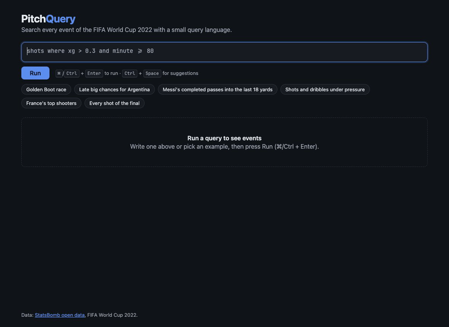
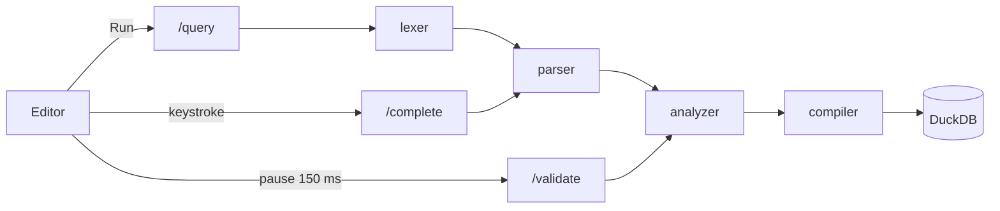

# PitchQuery

**A small search language for football match events, with an editor that autocompletes
as you type and explains every mistake.** Built from scratch on StatsBomb's open data for
the FIFA World Cup 2022: a hand-written lexer and parser, a semantic analyzer, a compiler
to SQL, and a CodeMirror front end.

[](https://github.com/lucasfreirec/pitchquery/actions/workflows/ci.yml)




```
shots where xg > 0.3 and team = "Argentina" and minute >= 80
shots where outcome = "Goal" and period < 5 | count by player | sort desc | limit 10
```

## Quick start

You need Docker.

```sh
git clone https://github.com/lucasfreirec/pitchquery.git
cd pitchquery
docker compose up
```

Open **http://localhost:8080**. The first start downloads the World Cup data from
StatsBomb's GitHub and builds the dataset (a few minutes, depending on your connection);
later starts are instant.
The API and its interactive docs are on http://localhost:8000/docs.

Ports taken? `PITCHQUERY_PORT=9080 PITCHQUERY_API_PORT=9000 docker compose up`.

## The language

A query names what to search, filters it with `where`, then pipes the result through
stages.

| Query | What it finds |
|-------|---------------|
| `shots where outcome = "Goal" and period < 5 \| count by player \| sort desc \| limit 10` | The Golden Boot race (period 5 is the penalty shootout) |
| `shots where xg > 0.3 and team = "Argentina" and minute >= 80` | Argentina's late big chances |
| `passes where player = "Lionel Messi" and outcome = "complete" and end_x > 102` | Messi's completed passes into the last 18 yards |
| `events where type in ("Shot", "Dribble") and under_pressure = true` | Shots and dribbles made under pressure |
| `shots where team = "France" \| count by player \| sort desc \| limit 5` | France's top shooters |
| `carries where end_x between 102 and 120 and not team = "France"` | Carries into the box by anyone but France |

- **Entities:** `events`, `shots`, `passes`, `dribbles`, `carries`, `pressures`.
- **Conditions:** `=` `!=` `<` `<=` `>` `>=`, `in (…)`, `contains "…"`, `between … and …`,
  combined with `and`, `or`, `not` and parentheses.
- **Stages:** `count [by field]`, `sort asc|desc [field]`, `limit n`, `select a, b`.
- **Fields:** `team`, `opponent`, `player`, `position`, `type`, `minute`, `period`, `x`,
  `y`, `end_x`, `end_y`, `outcome`, `xg`, `body_part`, `under_pressure`, `play_pattern`, …

Full grammar (EBNF), semantics and every error message:
[docs/grammar.md](docs/grammar.md).

## What the editor does

- **Autocompletion that knows the grammar.** After a field it offers only the operators
  valid for its type; after `team =` it offers the 32 teams, most frequent first; after
  `count by player |` it knows only `player` is left.
- **Every mistake explained, with a fix.** Errors and warnings are underlined as you type,
  all of them at once, with a one-click "did you mean":

  | You type | You get |
  |----------|---------|
  | `shots where xgg > 0.3` | Unknown field `xgg`. Did you mean `xg`? |
  | `shots where xg > "high"` | `xg` is a number; expected a number, got a string. |
  | `passes where xg > 0.3` | `xg` only exists for `shots`. |
  | `shots where team = "Argentna"` | Warning: no team `Argentna` in the data. Did you mean `Argentina`? |
  | `shots wher xg > 0.3` | Expected `where`, `\|` or end of query, got `wher`. Did you mean `where`? |
  | `shots where player = "Mbape"` | Warning: … Did you mean `Kylian Mbappé`? |

- **Results as a table or on the pitch:** shots as circles sized by xG (goals in gold),
  passes and carries as arrows.

## How it works



Design choices worth a look:

- **Hand-written lexer and recursive descent parser**
  ([parser.py](backend/pitchquery/lang/parser.py)), for exact error spans and messages.
  Precedence comes from the call structure; `between … and …` and the boolean `and` never
  clash because the predicate consumes its own `and`.
- **Parser-driven autocompletion.** Rather than a second state machine, completion parses
  the text before the cursor and asks the parser which tokens it expected at the end, so
  completion and grammar can never drift apart.
- **An analyzer that reports everything.** Unknown fields, type errors, fields an entity
  never has, unknown values, all in one pass, with Damerau–Levenshtein suggestions that
  ignore case and accents and match single words of names.
- **Safe SQL by construction.** Values are always bound parameters; column names come
  from the schema, never from the query text. A test pushes injection payloads through
  every operator.
- **Property-based tests.** Hypothesis generates random ASTs, prints them and parses them
  back (round trip), and throws arbitrary text at the parser, which may only ever raise
  its own `ParseError`.

More in [docs/architecture.md](docs/architecture.md).

## Performance

Apple Silicon laptop, 234,637 events, from [docs/performance.md](docs/performance.md)
(`make bench`):

| Step | Typical time |
|------|--------------|
| Parse | ~25 µs |
| Parse + semantic analysis | ~85 µs |
| Compile to SQL | ~5 µs |
| Autocompletion (per keystroke) | 7–550 µs (target: 20 ms) |
| Whole query end to end (analysis + DuckDB + fetch) | 2–6 ms |

## Development

Requires Python 3.12 with [uv](https://docs.astral.sh/uv/) and Node 22.

```sh
make setup   # install dependencies and the pre-commit hooks
make data    # download StatsBomb data and build data/events.parquet (cached)
make dev     # API on :8000 and the Vite app on :5173, with hot reload
make test    # pytest (incl. hypothesis) + Vitest
make lint    # ruff, mypy --strict, ESLint (type-aware), Prettier, tsc
make bench   # writes docs/performance.md
```

```
backend/
  pitchquery/
    lang/        lexer, parser, ast, analyzer, compiler, complete, suggest, schema
    data/        StatsBomb download and flattening
    engine.py    DuckDB execution with timeout and row cap
    api.py       FastAPI
  tests/         unit, golden queries on real data, property tests, API tests
  benchmarks/
frontend/src/
  editor/        CodeMirror setup, highlighting, quick fixes
  components/    results, table, pitch
  api.ts  pitch.ts
docs/            grammar, architecture, performance
```

## Data

Data provided by **[StatsBomb](https://statsbomb.com/)** through its free
[open data](https://github.com/statsbomb/open-data) repository: every event of the 64
matches of the FIFA World Cup 2022. The data is downloaded at build time and never
committed to this repository.

<!-- StatsBomb asks for its logo with any published work. Download it from
     https://statsbomb.com/media-pack/, save it as docs/img/statsbomb-logo.png, and
     uncomment the next line.
<a href="https://statsbomb.com/"></a>
-->
