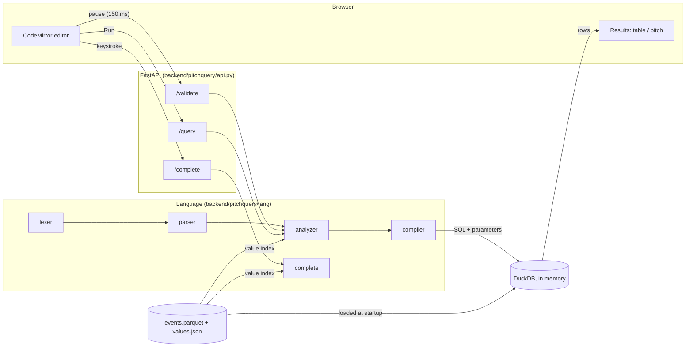
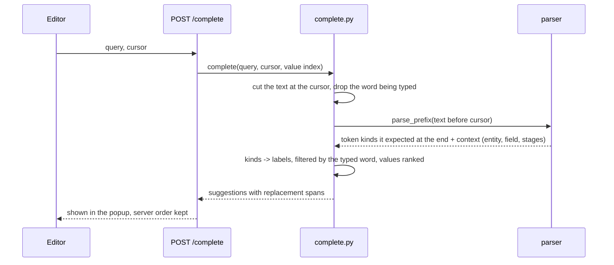
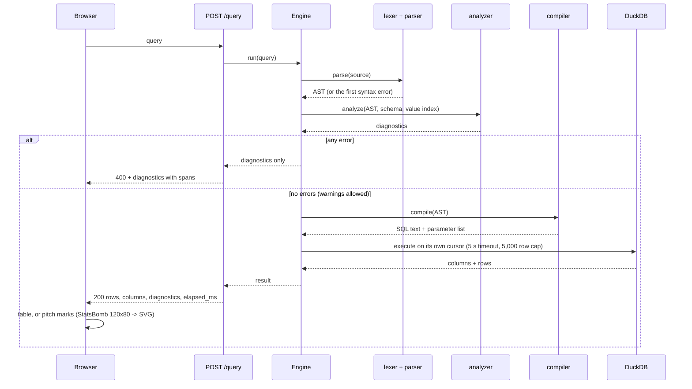
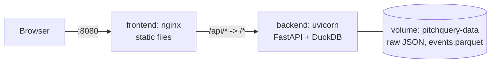

# Architecture

PitchQuery is a small language implementation (lexer, parser, analyzer, compiler) behind
an HTTP API, with a browser editor in front and DuckDB underneath.

## Three requests

### 1. Typing: keystroke → `/complete` → suggestions

Completion asks the real parser what it expected at the end of the input, so it can
never disagree with the grammar ([grammar.md §7](grammar.md#7-autocompletion)). It
takes well under 1 ms ([performance.md](performance.md)).

### 2. Pausing: `/validate` → underlines

CodeMirror's linter waits 150 ms after the last change, then posts the whole query to
`/validate`. The analyzer returns **every** diagnostic with its span and "did you mean"
suggestions; the editor underlines each span (red for errors, yellow for warnings) and
turns suggestions into one-click fixes. Results computed for an older version of the
text are discarded.

### 3. Running: `/query` → lexer → parser → analyzer → compiler → DuckDB → pitch

## Backend modules

| Module | Role |
|--------|------|
| `lang/lexer.py` | Source → tokens with spans. One pass, raises `ParseError` on the first bad character. |
| `lang/parser.py` | Recursive descent, one method per grammar rule; builds the AST. Also records what it expected at the end of input, for completion. |
| `lang/ast.py` | Frozen dataclasses. Spans are excluded from equality. |
| `lang/schema.py` | Fields, types, operators per type, which entities have which fields. |
| `lang/analyzer.py` | Semantic checks; returns all diagnostics in source order. |
| `lang/suggest.py` | Damerau–Levenshtein distance and "did you mean" ranking. |
| `lang/compiler.py` | AST → one parameterised DuckDB statement; stages become nested subqueries carrying row order in `_ord`. |
| `lang/complete.py` | Autocompletion on top of `parse_prefix`. |
| `lang/printer.py` | AST → canonical source (round-trip tests, future formatter). |
| `engine.py` | Loads the Parquet file into in-memory DuckDB; check → compile → execute with timeout and row cap. |
| `api.py` | FastAPI app, Pydantic models, status codes. |
| `data/` | Download (cached), flatten StatsBomb events, write Parquet and the value index. |

## Frontend modules

| Module | Role |
|--------|------|
| `api.ts` | Typed client; 400 and 504 are answers (with diagnostics), not exceptions. |
| `editor/Editor.tsx` | CodeMirror 6: completion source → `/complete`, lint source → `/validate`. |
| `editor/language.ts` | Stream tokenizer for syntax highlighting. |
| `pitch.ts` | StatsBomb coordinates → SVG; result rows → shots, arrows and dots. |
| `components/` | Results states, table, pitch. |

## Data pipeline

`make data` (or the Docker entrypoint on first start):

1. Download `matches/43/106.json`, then every match's `events/` and `lineups/` JSON from
   [statsbomb/open-data](https://github.com/statsbomb/open-data), cached in `data/raw/`.
2. Flatten each event into one row: nested names become strings, locations become
   `x`/`y`/`end_x`/`end_y`, player names use lineup nicknames, completed passes get
   `outcome = "Complete"` (StatsBomb leaves it out).
3. Write `data/events.parquet` (DuckDB, zstd) and `data/values.json`, the distinct values
   of every string field by frequency, used for completion and "did you mean".

## Deployment

`docker compose up` builds both images. The backend's entrypoint builds the dataset into
the volume if it is missing, then starts the API; the frontend waits for the backend's
health check. nginx serves the built app and proxies `/api`, so the browser only ever
talks to one origin.
